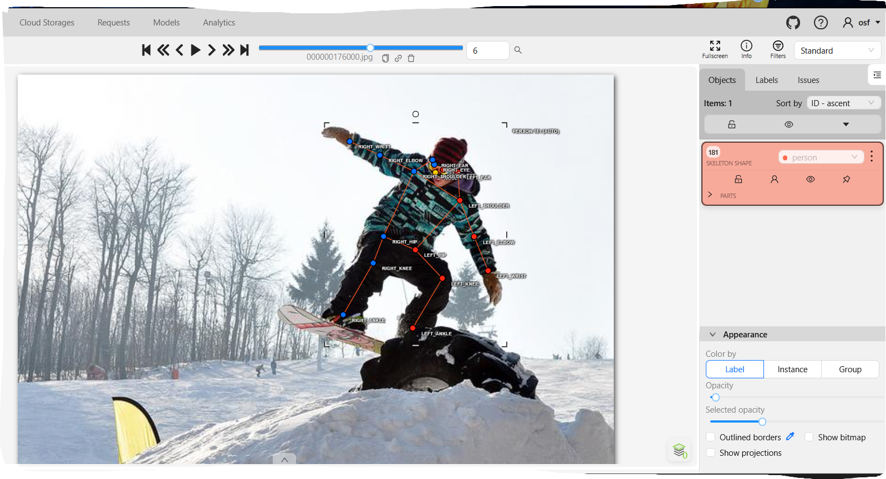
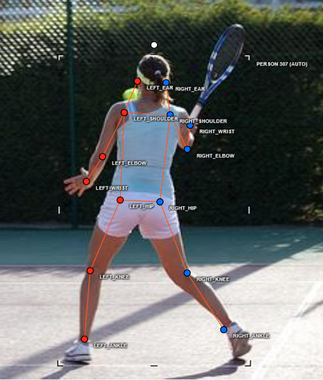
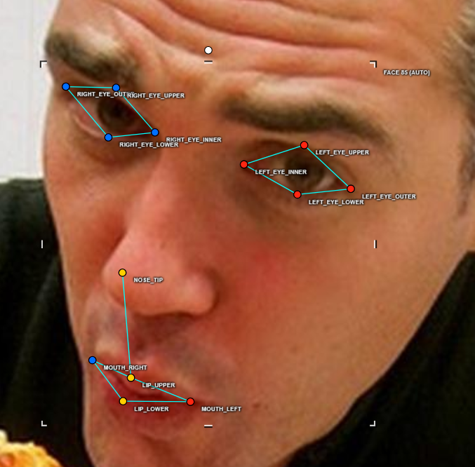
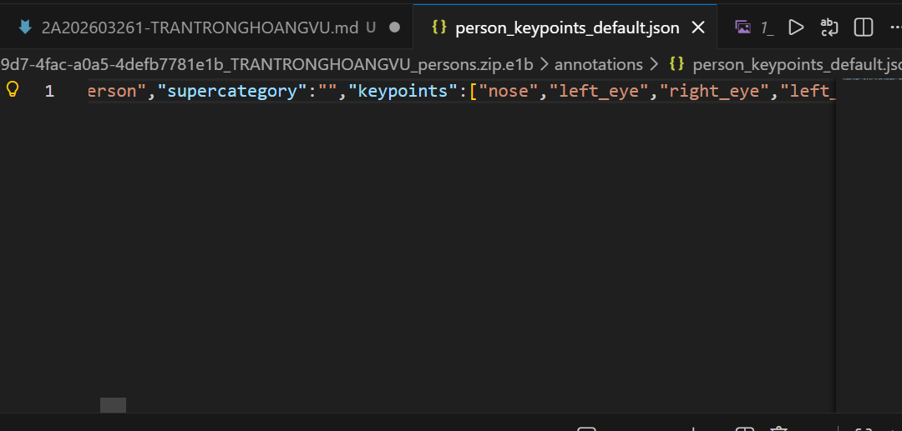

# Báo cáo cá nhân — HoVaTen-MSSV

Đổi tên file theo quy tắc `MSSV_HoTen.md`. Ví dụ: `20241234_NguyenVanAn.md`.

Dữ liệu: 12 ảnh người COCO val2017 (Lin et al., 2014) và 8 ảnh chân dung Wikimedia Commons, chỉ dùng trong lớp.

## 0. Thông tin học viên

- Họ tên: TRẦN TRỌNG HOÀNG VŨ
- MSSV:2A202603261
- Email:REALHOANGVU2004@GMAIL.COM
- Link repository:https://github.com/HoangVu2004/K5-L2-DAY04-TRANTRONGHOANGVU-2A202603261-KeypointPose
- Phiên bản CVAT (Help → About):
- Máy: hệ điều hành _win11__ · RAM _16__ GB · chạy CVAT chế độ đầy đủ / lite
- Bộ ảnh (`src/exports/assignment.json` do `lab.py setup` tạo): có / không
- Giờ bắt đầu:
- Giờ kết thúc:

## 1. Kiểm tra label (CP0)

| Label | Kiểu | Số điểm | Tên điểm đúng bảng của lab? | Đúng thứ tự? | Số cạnh |
|---|---|---:|---|---|---:|
| `person` |skeleton |17 |có |đúng |19 |
| `face` |skeleton |13 |có |đúng |13 |

Mẫu `person` dựng theo người quay mặt về camera (các điểm `left_*` nằm bên phải khung mẫu)? Có

Cách đổi cờ `occluded` / `outside` cho **một điểm** trên phiên bản CVAT này (một câu):

Chọn điểm cần đổi, sau đó nhấn phím số 0 (outside), 1 (occluded), hoặc 2 (visible) trên bàn phím (hoặc chọn trong menu thuộc tính)

## 2. Số lượng đã gán và thời gian (CP1, CP2)

| Nhóm ảnh | Số ảnh | Số skeleton đã gán | Số người dưới 60 px (không gán) | Số poster / gương / màn hình bỏ qua | Thời gian (phút) |
|---|---:|---:|---:|---:|---:|
| `easy` | 5 | 7|0 |0 | 25|
| `occluded` | 3 |4|0 |0 |21 |
| `back` | 2 |2 |0 |0 | 16|
| `small` | 1 |3 | 1|0 |10 |
| `crowd` | 1 |3 |2|1 | 15|
| `faces` | 8 |8 | — |0 |24 |

- Số ảnh người đã xong ở mốc phút 105: ___ / 10
- Thời gian thực tế (phút): CP1 ___ · CP2 ___ · CP3 ___
- Ảnh tốn thời gian nhất là ảnh nào, vì sao?

...

## 3. Bảng ca khó (CP1, CP2)

Mỗi điểm bạn phân vân một dòng, nhất là phân vân giữa `v = 1` và `v = 0`, hoặc không chắc hướng người.

| Ảnh | Người / mặt | Điểm | Cờ đã chọn | Phân vân giữa | Lý do chọn |
|---|---|---|---:|---|---|
| | | | | | |
| | | | | | |
| | | | | | |

## 4. Bảng tự review (CP3)

Đi từ ảnh cuối về ảnh đầu. 5 ảnh người (ít nhất 2 ảnh `back` hoặc `crowd`) và 3 ảnh mặt. Ít nhất 8 dòng, kể cả dòng `ok`. Ghi lỗi trước, sửa sau.

Mã lỗi dùng đúng một trong: `lr_swap`, `vis_flag`, `position`, `missing`, `extra`, `ok`.

| Ảnh | Người / mặt | Điểm | Mã lỗi | Ghi chú | Đã sửa? |
|---|---|---|---|---|---|
|000000030960 |Người 1 |Tất cả |OK |Kiểm tra trái/phải chính xác |CÓ |
|000000326480 |Người 1 | left_elbow|position |Chỉnh lại tâm khớp | Có|
|000000078170 | Người 1|Tất cả |	ok |Người quay lưng gán đúng |Có |
|000000351176 |người 2| right_knee |vis_fla |từ v=2 sang v=1 | có|
|000000054909 |người 1 |tất cả |ok |gán đúng 17 điểm | có|
|face_105668 |mặt 1 |mouth_left |póition |đưa về đúng khóe môi |có |
|face_204787 |mặt 1 |tất cả |ok |mắt trái phải đúng theo người | có|
|face_333134 |mặt 1 |tất cả |ok |các điểm mắt đặt đúng mí |có |

Tổng hợp số lỗi theo mã:

| `lr_swap` | `vis_flag` | `position` | `missing` | `extra` | `ok` |
|---:|---:|---:|---:|---:|---:|
| | | | | | |

Điểm còn phân vân giữa `v = 1` và `v = 0` (ghi cả hai lựa chọn và lý do chọn):

...

## 5. Kiểm file xuất và kết quả tự kiểm (CP4)

Tự kiểm tay trong file JSON:

| File | Người / mặt kiểm (ảnh, thứ tự) | Số phần tử `keypoints` | Điểm `outside` ra `v = 0`, `occluded` ra `v = 1`? | `num_keypoints` khớp? |
|---|---|---:|---|---|
| `TRANTRONGHOANGVU_persons.zip` |000000030960, người 1 |51 |có |có |
| `TRANTRONGHOANGVU_persons.zip` |000000326480, người 1 |51 | Có| Có|
| `TRANTRONGHOANGVU.zip` |face_105668, mặt 1 | 39|có | có|

Sau khi xuất, CVAT ghi `occluded` thành `v = 1` và `outside` thành `v = 0`. Tọa độ của điểm `outside` trong file là `0, 0` hay tọa độ cũ? vẫn theo tọa độ cũ vat 2.x

Hai job đã chuyển sang completed trên CVAT? Có

Dán phần **TÓM TẮT** in ra từ `src/check_submission.py`:

```text
- File person: TRANTRONGHOANGVU_persons.zip
  Số ảnh: 12 · số skeleton `person`: 19 · mỗi annotation 51 số
  Skeleton theo ảnh: 000000030960=2, 000000054909=2, 000000078170=1, 000000100510=2, 000000157271=2, 000000175703=1, 000000176000=1, 000000194027=1, 000000205650=1, 000000326480=3, 000000351176=2, 000000558066=1
  Cờ v: v=2 283 (88%) · v=1 0 (0%) · v=0 40 (12%)
  num_keypoints trung bình: 14.9
- File face: TRANTRONGHOANGVU_faces.zip
  Số ảnh: 8 · số skeleton `face`: 8 · mỗi annotation 39 số
  Skeleton theo ảnh: face_105668=1, face_204787=1, face_256814=1, face_333134=1, face_380639=1, face_380754=1, face_442231=1, face_575921=1
  Cờ v: v=2 104 (100%) · v=1 0 (0%) · v=0 0 (0%)
  num_keypoints trung bình: 13.0
- Ghi chú: 40 điểm v = 0 vẫn mang tọa độ cũ (CVAT 2.x xuất như vậy; chuẩn COCO ghi 0, 0). Không phải lỗi: điểm v = 0 bị bỏ qua khi huấn luyện và khi chấm.
- Số [LỖI]: 0 · số [CẢNH BÁO]: 0
Kết quả: ĐẠT
```

Các `[CẢNH BÁO]` còn giữ nguyên và lý do:

...

## 6. Ảnh chụp màn hình

1. Label `person` trong label constructor (đủ 17 điểm có tên):

   

2. Một người quay lưng đã gán, cờ đã đặt:

   

3. Một khuôn mặt đã gán 13 điểm, phóng to vùng mắt:

   

4. Một đoạn JSON xuất của một người:

   

Nguồn ảnh: COCO val2017 / Wikimedia Commons.

## 7. Tự đánh giá

1. Lỗi bạn mắc nhiều nhất hôm nay, và cách bạn sẽ tránh ở dự án thật:

   mắc việc làm tay khá lâu sử dụng model từ giờ trở đi sẽ nhanh hơn

2. Một quy tắc bạn đề xuất thêm vào guideline (kèm ảnh ví dụ nếu có):

   đối với người mặc quần áo rộng hoặc váy điểm hông left hip right hip nên đặt vị trí ước lượng của khớp xương chậu thay vì nếp gấp quần áo

3. Nhãn của bạn đi vào model ở đâu? Chọn một lỗi bạn đã sửa và nói nó sẽ làm model học sai thế nào (heatmap, trọng số trong loss, hay bước lật ảnh):

   Nhãn của tôi được dùng để tạo Heatmap làm Ground Truth cho model. Tôi đã sửa lỗi lr_swap (đổi nhầm tay trái/phải). Nếu không sửa, khi model thực hiện bước Horizontal Flipping (Lật ảnh) để tăng cường dữ liệu, nhãn sẽ bị sai hoàn toàn. Điều này khiến model không thể học được sự khác biệt giữa hướng mặt và hướng lưng của người, làm giảm độ chính xác OKS nghiêm trọng

## 8. Khó khăn và lỗi kỹ thuật

model của face phải sửa lại bằng tay do không gán chính xác đúng vị trí của ảnh

## Bonus (nếu làm)

### B1 — 3 ảnh người khó thêm

| Ảnh | Số skeleton | Số người dưới 60 px | Ca khó nhất |
|---|---:|---:|---|
| | | | |
| | | | |
| | | | |

Kết quả `src/check_submission.py` cho `HoVaTen_bonus_persons.zip`:

```text
(dán ở đây)
```

### B2 — 5 ảnh khuôn mặt đen trắng / hồng ngoại

Ảnh không màu khó hơn ở điểm nào? Kính râm trên ảnh hồng ngoại có còn là `v = 1` không?

...

### B3 — Model so với nhãn của tôi (không tính điểm)

- Demo đã dùng:
- Ảnh đã thử:

1. Model có trả điểm cho khớp bị che, hay khớp ngoài ảnh không? Confidence ở các điểm đó thế nào?

   ...

2. Với người quay lưng, model có đổi trái/phải không?

   ...

3. Bộ điểm của model có giống 17 điểm COCO không?

   ...

## 9. Tài liệu tham khảo và công cụ AI đã dùng

sử dụng công cụ yolo v11 pose để nhận diện con người
tích hợp thêm công cụ yolo face 13ft
